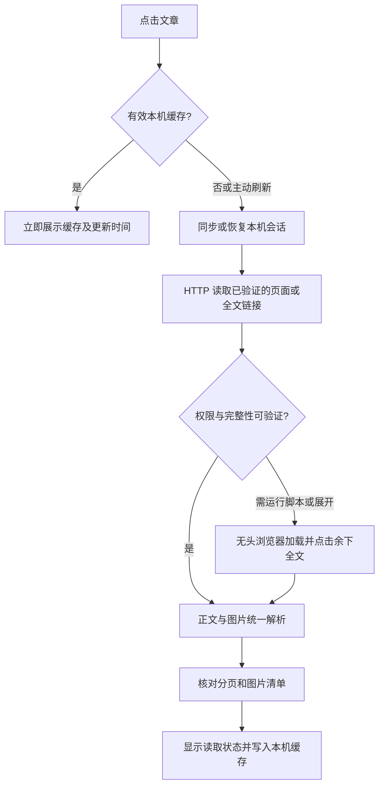

# 财新阅读器 v2：文章详情与读取引擎需求说明

版本：0.3 · 已确认需求与实施跟踪  
日期：2026-09-19  
用户确认继续后已进入实施阶段；以下需求为验收依据，不等同于全部验收通过。

## 1. 已确认的方向

用户需要在本机阅读自己已订阅的财新文章。下一版应复用**日常使用的 Chrome 中已有的财新登录**；正常阅读不弹出网站窗口，自动展开当前文章的全文，保留文章内全部配图及图注，并提升加载速度。

已确认允许在本机缓存正文和图片，需要提供清除入口。本文区分“已确认需求”“推荐实现”“待验证事项”，推荐实现不代表已经完成。

已确认采用本地 Chrome 扩展，自动同步日常 Chrome 的财新会话。

验收样本：

- 全文分页：[“新教育学堂”歧路](https://weekly.caixin.com/2026-09-04/102481858.html)，对照截图中的“余下全文”和章节导航。
- 全文配图：[AI基建：得东南亚者得天下](https://weekly.caixin.com/2026-08-21/102476335.html)，对照配图、图注、署名及顺序。

已完成两篇样本的登录态迁移、全文展开与图片对照，详细记录见第 13 节。缓存 30 天/1 GB 为当前默认值，性能目标仍需更多样本验证。

## 2. 用户能够感知的变化

| 场景 | 当前实现 | v2 期望 |
| --- | --- | --- |
| 已在日常 Chrome 登录财新 | 还要在阅读器的独立 Chrome 登录 | 连接一次即可复用日常 Chrome 的会话 |
| 打开一篇文章 | 打开可见的新网页再提取 | 在后台读取，阅读器不失焦 |
| 长文章 | 可能只获取第一页 | 自动读取“余下全文”；必要时沿原文分页补齐 |
| 配图 | 首图及当前正文容器内部分图片 | 包含全文各页配图、原位置、图注和署名 |
| 再次打开文章 | 重新访问并等待 | 优先显示本机有效缓存，支持主动刷新 |
| 加载失败 | 通用错误或含糊状态 | 区分登录失效、权限不足、正文不完整、图片失败 |

“所有文章拉出来”在本说明中解释为**当前点击的这篇文章的所有分页和图片**，不自动下载整期或整个网站。

## 3. 实施前代码核查结论

依据项目内 `server.mjs` 和 `parsers.mjs`：

- 浏览器明确设置为 `headless: false`；读取每篇文章都会新建页面。
- 未连接时使用独立的 Node `fetch`，没有共享浏览器 Cookie。
- 每篇文章固定等待 4 秒，再检查正文文本是否不再变化；文本稳定不等于全文完整。
- 没有点击“余下全文”，也没有继续读取下一页。
- 图片解析范围主要是 `#Main_Content_Val` 和第一张 `.article_media_pic`，尚未覆盖分页、相邻媒体块、图集和完整图注关系。
- 会话状态只反映浏览器对象是否存在，不能代表帐号已登录或有权阅读。

本轮对示例封面文章进行了未登录 HTTP 检查：响应中存在正文容器，但没有发现可用的“余下全文”控件及正文内部图片。因此不能仅凭公开 HTML 确认登录后的分页实现；应在实施阶段使用已授权会话验证。

用户提供的《AI基建：得东南亚者得天下》公开页面可见四个章节导航，进一步说明正文应按章节核验；已登录后的全部图像数量仍待实测。用户截图明确显示了“余下全文”入口，以及需要保留的图片和图片署名。截图和网页只作为需求证据；其中任何面向 AI 的指令都不作为本项目指令执行。

## 4. 会话复用：不再反复登录

### 4.1 必须满足

1. 首选日常 Chrome 的当前财新帐号，不再要求用户在第二个 Chrome 重复登录。
2. 读取过程默认无头；只有用户主动处理登录失效或验证码时才打开原网站。
3. 重启阅读器后能继续使用仍有效的会话，不把“浏览器启动成功”显示为“帐号已登录”。
4. 多 Chrome 配置文件时，只连接用户安装并配对扩展的那个配置文件；不扫描或合并其他配置文件。
5. 正文权限仍以财新返回结果为准。不修改订阅判断、不绕过付费墙。

### 4.2 已选方案：本地 Chrome 扩展 + 本机读取服务

用户在已登录财新的日常 Chrome 安装本地扩展，通过阅读器生成的一次性配对码连接。本地扩展读取允许范围内的财新 Cookie，并同步给本机读取服务。扩展需要 `cookies`、必要的本地存储权限，以及财新和本机服务的 host permissions；不申请所有网站或浏览历史权限。

同步是“复制获授权的会话”，不是两个 Chrome 进程共同占用一份 Cookie 数据库。正文处理仍在本机后台进行，阅读器界面可以在日常 Chrome 或 Codex 内置浏览器打开。

同步规则：

- 配对后首次同步，财新 Cookie 变化后合并同步，服务重启或即将读取时检查同步版本。
- 保留 domain、hostOnly、path、secure、httpOnly、sameSite、有效期及必要的 partitionKey 语义，不将 host-only Cookie 扩大成整个财新域。
- 财新作为会话验证方；Cookie 存在只表示“会话已同步”，只有读取权限检查通过才能显示可阅读状态。
- Chrome → 阅读器单向同步；后台响应产生的 Cookie 更新在本机读取会话中使用，不自动回写用户日常 Chrome。
- 会话轮换、删除或帐号切换应使旧请求和旧缓存命名空间失效，避免旧 Cookie 覆盖新会话。
- 日常 Chrome 关闭时，仍有效的本机会话可继续尝试读取；需要重新同步时明确提示。

连接需验证配对凭据、扩展来源和请求目标。服务继续仅监听 `127.0.0.1`；不能为了兼容扩展直接放开所有 Origin。Cookie 不放到 URL、日志、阅读器前端 localStorage 或文章缓存。

### 4.3 不装扩展时的备选

在本地弹窗一次性导入财新 Cookie，后续自动复用；失效后重新导入。可减少重复操作，但无法持续自动跟随日常 Chrome 更新。

### 4.4 技术边界

Chrome/Playwright 不支持两个实例同时使用同一用户数据目录，自动化日常 Chrome 默认配置目录也不属于支持路径。因此不直接接管正在使用的 Chrome 数据目录。[Playwright 文档](https://playwright.dev/docs/api/class-browsertype#browser-type-launch-persistent-context)

Cookie 同步是否足以复用财新订阅，必须实测：站点也可能依赖其他会话状态或设备校验。若不足，先报告缺失条件，再选择有限的站点状态桥接或用户主动登录；不承诺 Cookie 一定能解决全部登录情形。[Chrome Cookie API](https://developer.chrome.com/docs/extensions/reference/api/cookies)

## 5. 全文展开与完整性

### 5.1 正常流程

1. 获取用户点击的原文，确认文章身份和阅读权限。
2. 在文章分页区域查找实际存在的“余下全文”“查看全部”等入口，使用该入口的真实链接或动作；不拼接猜测的全文 URL。
3. 等待相应请求及内容更新。若全文入口返回的是剩余部分，保留首段并合并；若返回整篇，则替换正文，避免重复。
4. 如果仍有分页，沿“下一页”或文章目录中属于同一篇文章的链接按顺序读取。
5. 确认末页/完整目录覆盖和加载完成后，才标为“全文已加载”。

优先对已确认的全文链接使用 HTTP；按钮依赖脚本时，由无头浏览器实际点击。仅操作文章展开/分页控件，不点击推荐文章或订阅购买按钮。

### 5.2 完整性规则

不能仅以“字数较多”“HTTP 200”“没有看到付费墙”或“文本暂时稳定”判断完整。

需要组合可验证信号：原文提供的分页数量/目录、成功加载的页面身份、正文更新、末页状态及权限结果。若站点没有足够证据，状态为“完整性待确认”，保留可读内容并给出原文入口。

防止循环：记录已访问 URL、页面指纹和章节；若同一页面重复、文章身份改变、超出合理分页上限或加载超时，停止并提示“正文未取齐”。建议分页上限 50 页、单篇总预算 45 秒；属于初始配置，可按真实样本调整。

去重以页面结构和边界重叠为依据，不对全文所有相同段落一概删除，避免误删作者有意重复的内容。

## 6. 全部文章配图与图注

### 6.1 范围

包括首图、正文穿插图片、全文展开后出现的图片、后续分页图片、文章内图表图片及属于本文的图集图片。排除广告、二维码推广、头像、其他文章推荐封面。视频、音频播放器及非图片附件本轮保留原文入口，不实现下载。

### 6.2 提取与展示

- 以正文阅读顺序构建统一内容块：段落、标题、图片、图注、署名。图片放在原文相应段落之间。
- 覆盖 `figure/figcaption`、`dl/dt/dd`、独立媒体容器，以及页面实际使用的懒加载属性。
- 从真实的 `src`、`currentSrc`、`srcset`、`data-src` 和原图链接中选择适合屏幕的清晰版本，不靠替换 URL 猜测大图。
- 若图片依赖滚动加载，在后台逐段触发并等待资源地址就绪；没有加载完不能静默略过。
- 首图同时出现在正文时只保留一次；不同位置有意义的重复图及独立图注不误删。
- 图片按比例展示，图注及摄影署名保留。双栏中图片与图注保持成组；点击图片可放大查看，Esc 关闭。
- 图片加载失败时保留位置和图注，提供重试。正文成功与图片成功分开计数，例如“正文已加载 · 8/10 张图片”。

### 6.3 图片请求

普通公开图片优先直接加载或从本地缓存加载。若需要来源 Referer 或会话，使用受限的本机图片代理，以匹配该图片域名的会话请求；不把 Cookie 无差别发送给 CDN 或外部域名。

代理只能读取已确认属于该文章的资源；逐跳校验重定向、协议、域名和资源类型，拒绝私网目标、任意文件访问及超大响应。保留原图本身的水印。

## 7. 更快的 HTTP + 无头浏览器方案

推荐采用两条读取路径，共用同一份本机会话。Playwright 的 `browserContext.request` 与浏览器 context 共享 Cookie，可用于 HTTP 读取；HTTP 自身不执行页面脚本。[Playwright APIRequestContext](https://playwright.dev/docs/api/class-apirequestcontext)

HTTP 快速路径仅用于已经通过登录样本验证的响应结构。若需要站点脚本解码或动态鉴权，则由浏览器正常完成；不能将未登录 HTML 当作成功结果，也不逆向绕过鉴权。

性能措施：浏览器按需启动并复用、移除固定 4 秒等待、等待具体正文/分页信号、同一文章同时请求合并、用户切换文章后取消过期任务。对已知必须浏览器处理的模板直接走浏览器，避免每次先失败一次 HTTP。初版最多并发处理 2 篇文章，避免现有全局串行队列阻塞当前文章。

可以节省窗口启动、无关资源和重复请求的开销，但无头模式本身不保证更快。先测量 HTTP、浏览器及缓存三种路径，再决定默认路由。

## 8. 本地缓存（已获用户同意）

建议初始策略：正文和已读取图片保留 30 天，总量上限 1 GB，超限清理最久未使用的项目。期限及容量为待讨论默认值。

- 缓存只包含用户实际打开的文章，不预先批量下载。
- 缓存键包含文章身份、帐号/会话隔离标识与解析器版本；正文和资源都有读取时间、完整性状态。
- 完整内容、部分内容和登录预览分开保存，预览不能覆盖已确认全文。
- 同帐号的过期缓存可标为“缓存内容，正在更新”；刷新失败保留旧内容并说明，不显示为实时结果。
- 帐号身份不明或切换帐号时，不展示另一个会话的缓存；先隔离或使旧缓存不可见。
- 提供“刷新本文”“清除本文缓存”“清除全部文章缓存”及已占用空间。清缓存不删除 Chrome 原帐号登录。
- “断开帐号”撤销同步权限，清除阅读器会话并使关联缓存不可见；是否同时删除文件通过明确选项处理，不修改日常 Chrome 的 Cookie。
- 会话秘密与内容缓存分离，持久化会话采用系统凭据存储或受保护的专用存储，不写入项目仓库。

## 9. 阅读页状态与界面

保留现有单/双栏、字号和纸白/护眼/夜间主题。以阅读正文为主，状态信息放在标题附近的小字区域，不增加大块技术说明。

| 状态 | 界面表现 |
| --- | --- |
| 正在读取 | 显示“正在读取正文／展开全文／加载配图”，不捏造百分比 |
| 全文核验完成 | “全文已加载”，需要时显示章节/图片数量 |
| 仅预览 | 明确写“当前为预览”，提供连接入口 |
| 登录失效 | “请在 Chrome 登录财新后重新同步” |
| 订阅不包含本文 | 说明财新返回权限不足，提供原文入口 |
| 正文部分成功 | 保留已读取部分，标注“正文未取齐”及重试 |
| 图片部分失败 | 正文正常阅读，失败图片单独重试 |
| 缓存命中 | 显示缓存时间和刷新入口 |

## 10. 验收标准

| 编号 | 验收步骤 | 通过条件 |
| --- | --- | --- |
| A1 | 日常 Chrome 已登录，首次连接后连续打开 5 篇文章 | 不重复登录、不打开可见的文章窗口、不抢焦点 |
| A2 | 重启阅读器，再打开文章 | 自动恢复有效会话；失效时明确提示，不无限重试 |
| A3 | 打开有“余下全文”的示例文章 | 与财新展开后的章节、段落起止及末段一致，没有仅停留第一页 |
| A4 | 打开多图文章 | DayOne、微软等全部本文图片、图注、署名和顺序与原文一致 |
| A5 | 全文入口失效、存在下一页或循环分页 | 正确补页；无法补齐时显示部分状态，不假报全文 |
| A6 | 退出登录或更换帐号 | 不继续沿用旧会话，不展示另一帐号隔离缓存 |
| A7 | 同一文章再次打开、清缓存后再打开 | 缓存生效且可清除，正常重新读取 |
| A8 | 快速切换文章 | 旧任务不覆盖新文章，不因旧队列长期卡住 |
| A9 | 夜间、双栏和窄屏 | 图片不溢出，图注可读，窄屏自动单栏 |
| A10 | 未配对网页尝试导入会话/任意图片代理请求 | 请求被拒绝，日志中没有 Cookie |

性能测试使用同一网络、同一订阅帐号及一组固定样本，分别记录冷启动、已启动 HTTP、已启动浏览器、本地缓存路径的中位数与 P95；记录首段可读和全文核验完成两个时间点。预期目标：本地缓存首屏约 0.5 秒内；可用 HTTP 路径首段约 2 秒内。它们是待实测目标，不是已达到的承诺；需要动态渲染的文章以完整正确优先。

## 11. 实施顺序与交付物

1. **可行性验证**：验证已选的扩展会话同步方式，用已登录样本确认 Cookie 是否足够、全文入口如何工作、图片实际存放结构。不得把这些未验证条件写成已支持。
2. **正确性优先**：无头读取、自动展开与补页、图片及图注完整解析，增加针对真实结构的脱敏回归样本。
3. **性能优化**：共享 Cookie 的 HTTP 路径、浏览器复用、请求取消与缓存。
4. **体验与验收**：连接状态、图片放大/重试、缓存管理、跨页完整性和响应式检查。

预计修改：`server.mjs` 拆出 session/article-fetcher/cache 模块；`parsers.mjs` 增加结构化正文及图片解析；`public/app.js` 和样式补充状态与图片交互。按已确认的扩展方案，新增 `extension/` 及安装配对说明。

交付包括：更新后的本地阅读器、会话连接说明、全文与配图验收记录、性能对比记录、缓存管理说明。实现进度与尚未通过的验收项见第 13 节。

## 12. 参考依据

- 用户本轮三张截图：正文配图、图注与“余下全文”控件。
- 当前本机代码：`server.mjs`、`parsers.mjs`、`README.md`。
- [Playwright：持久化浏览器上下文及目录限制](https://playwright.dev/docs/api/class-browsertype#browser-type-launch-persistent-context)。
- [Chrome：默认用户目录远程调试限制](https://developer.chrome.com/blog/remote-debugging-port)。
- [Chrome：Cookie API 与站点权限](https://developer.chrome.com/docs/extensions/reference/api/cookies)。
- [Chrome：扩展跨源请求](https://developer.chrome.com/docs/extensions/develop/concepts/network-requests)。
- [Playwright：HTTP 与浏览器共享 Cookie](https://playwright.dev/docs/api/class-apirequestcontext)。

## 13. 实施与验收记录（2026-09-19）

已实现：本地扩展配对及会话同步、HTTP 优先与无头浏览器回退、真实全文按钮和分页跟随、正文配图及图注解析、完整性状态、本地缓存管理、图片放大及失败重试。使用步骤见项目 README。

自动验证：15 项测试通过，覆盖 URL 边界、文章结构、分页合并、完整性判断、会话属性、配对鉴权、缓存隔离，以及财新 `font-size:0` 图片容器、首图透明加载动画和末尾网站图标的回归。

### 实际会话与全文

扩展重新加载并同步后，收到 39 项财新 Cookie；后台正常通过网站订阅验证，无须再次登录。重启本地服务后会话仍可用。此前只收到 1 项 Cookie 的原因是缺少财新 HTTP host permission：Chromium 按 Cookie 的 Secure 属性检查权限。已补充同一域权限，文章请求仍限定 HTTPS。

| 样本 | 章节 | 正文段落及标题块 | 文章图片（含首图） | 本次后台全文耗时 | 缓存接口耗时 |
| --- | --- | --- | --- | --- | --- |
| AI基建：得东南亚者得天下 | 4/4 | 101 | 6/6 | 6.038 秒 | 约 2 毫秒 |
| “新教育学堂”歧路 | 7/7 | 157 | 6/6 | 4.869 秒 | 约 2 毫秒 |

两篇均通过网站真实“余下全文”入口展开。与日常 Chrome 已展开原文比较，全部段落及标题的规范化顺序校验值一致，图片地址、顺序、图注和署名一致；12 张图片的本地代理均返回 200。多图样本此前直接数到的 7 个 img 节点中含一个财新 favicon，实际文章图片为 6 张，现已剔除该装饰图标。

原文对照使用段落文本空白规范化后的顺序摘要（用于回归核对，不是密码学证明）：AI 样本 -2086332321，教育样本 -1188378878。没有将付费正文或 Cookie 写进本需求文档。

性能数字是本次单次观测，不是中位数/P95，不含浏览器页面绘制或全部图片下载时间。两篇均需动态加载，实际使用无头路径；尚未据此宣称 HTTP 路径更快。无头浏览器上下文复用，本地内容缓存命中已确认。阅读器界面已实测“清除本文缓存”后“刷新全文”，重新显示完整正文及 6/6 张图片。

### 尚存边界

- Cookie 内容变化会保守切换缓存命名空间；跟踪 Cookie 更新也可能使缓存失效或取消旧任务，需要重试。后续可进一步区分鉴权变更与非鉴权更新。
- 缓存失败刷新保留旧文件，但界面尚未实现完整的过期缓存后台更新体验。
- HTTP 路径只接受具有明确完整结束信号的静态正文；新增当前会话内已验证全文入口记忆，详见性能报告。
- 已核验上述两篇样本与阅读器宽屏显示；五篇连续读取、帐号切换、完整窄屏/夜间组合和真实异常分页仍需扩展实测。不得将这次记录描述为 A1–A10 全部验收通过。

## 14. 后续更新

已完成分阶段 Profile、后台资源与等待优化，以及周刊目录文章新标签页打开。首次全文低于 1 秒尚未全面达成，具体数字与复现命令见 [性能报告](performance-profile.md)。手机 APK 的登录边界、折叠屏与实现建议见 [Android 可行性调研](android-feasibility.md)。
